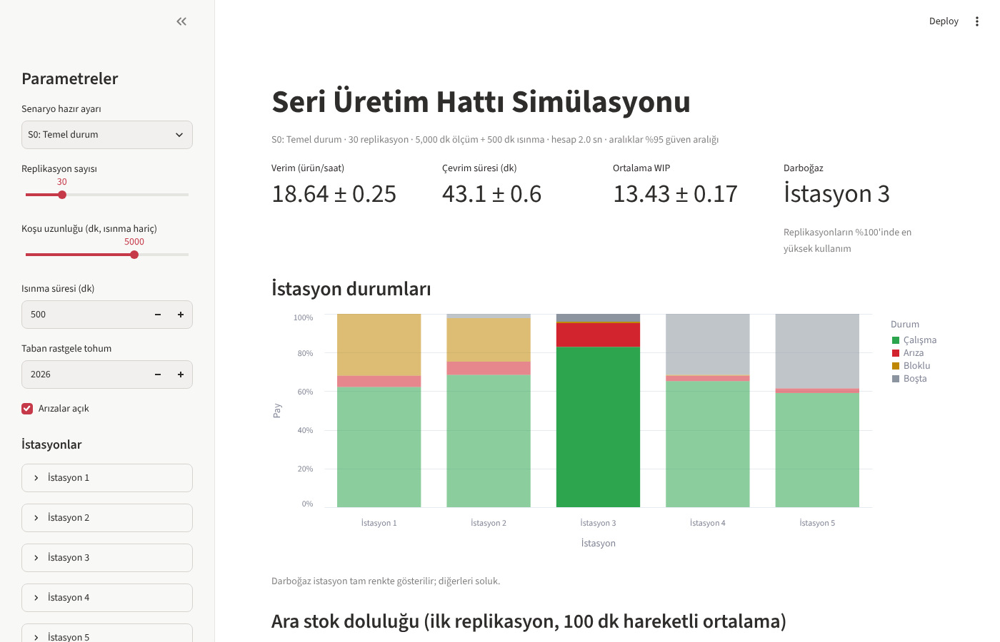
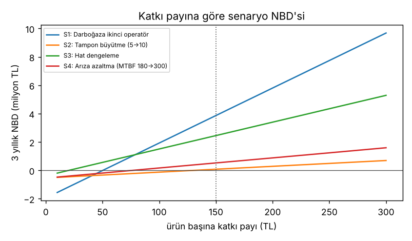
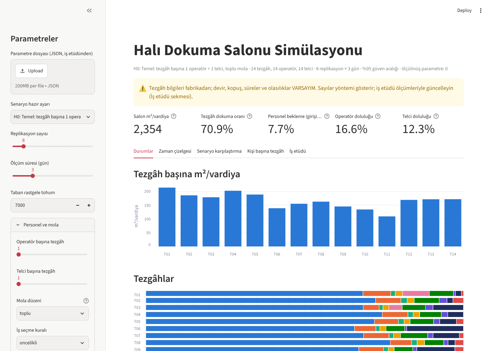

# SimPy Üretim Hattı Simülasyonu

Python ve SimPy ile beş istasyonlu seri bir üretim hattının ayrık olay simülasyonu. Proje, "hatta bir operatör ya da tampon eklersem çıktı ne kadar artar?" sorusuna, çoklu replikasyon ve %95 güven aralığıyla cevap veriyor.



## Hızlı başlangıç

```bash
python -m venv .venv
source .venv/bin/activate        # Windows: .venv\Scripts\activate
pip install -r requirements.txt

pytest                           # 51 test, ~2 dk
python -m src.mm1_dogrulama      # M/M/1 doğrulama tablosu  -> results/mm1_dogrulama.md
python -m src.deney              # senaryolar, Welch, tampon eğrisi -> results/deney_raporu.md
streamlit run app/panel.py       # parametre paneli
```

## Sonuçlar

### M/M/1 doğrulaması (μ = 1)

| ρ | Rep. | Teorik W_q | Sim. W_q (±%95 GA) | Sapma | Teorik L_q | Sim. L_q (±%95 GA) | Sapma |
|---|---|---|---|---|---|---|---|
| 0,5 | 30 | 1,0 | 0,999 ± 0,009 | −%0,07 | 0,5 | 0,500 ± 0,005 | −%0,08 |
| 0,8 | 30 | 4,0 | 4,007 ± 0,038 | +%0,17 | 3,2 | 3,207 ± 0,032 | +%0,23 |
| 0,9 | 50 | 9,0 | 9,017 ± 0,064 | +%0,18 | 8,1 | 8,115 ± 0,059 | +%0,19 |

Hedef %2-3 idi; en büyük sapma %0,23. Little yasası farkı en fazla %0,06.

### What-if senaryoları (30 replikasyon, ortak rastgele sayılar)

5.000 dk ölçüm ve 500 dk ısınma. Δ sütunları S0'a göre eşleştirilmiş farktır; köşeli parantez %95 güven aralığıdır.

| Senaryo | Verim (ürün/saat) | Çevrim süresi (dk) | Ortalama WIP | Darboğaz | Δ verim |
|---|---|---|---|---|---|
| S0 Temel durum | 18,64 ± 0,25 | 43,1 ± 0,6 | 13,43 ± 0,17 | İstasyon 3 | – |
| S1 Darboğaza ikinci operatör | 23,98 ± 0,27 | 30,5 ± 0,7 | 12,20 ± 0,32 | İstasyon 2 | +5,34 [+5,09, +5,58] |
| S2 Tampon büyütme (5→10) | 19,21 ± 0,23 | 70,8 ± 1,1 | 22,72 ± 0,31 | İstasyon 3 | +0,56 [+0,51, +0,62] |
| S3 Hat dengeleme | 21,25 ± 0,33 | 34,7 ± 1,0 | 12,30 ± 0,36 | İstasyon 3 | +2,60 [+2,50, +2,71] |
| S4 Arıza azaltma (MTBF 180→300) | 19,62 ± 0,26 | 41,1 ± 0,6 | 13,45 ± 0,18 | İstasyon 3 | +0,98 [+0,79, +1,17] |

**Yorum**

- **S1 en büyük kazancı veriyor** (+%29 verim) ve aynı anda çevrim süresini ve WIP'i düşürüyor. Darboğaz İstasyon 3'ten **İstasyon 2'ye** kayıyor; dokümanda tahmin edilen İstasyon 4 değil. Sebep: arızalarla birlikte İstasyon 2'nin etkin süresi (≈2,35 dk) İstasyon 4'ünkünden (≈2,16 dk) daha uzun.
- **S2 verimi yalnızca +%3 artırıyor** ama WIP'i 13,4'ten 22,7'ye, çevrim süresini 43'ten 71 dakikaya çıkarıyor. Dokümandaki "tampon büyütmek WIP'i şişirebilir" uyarısı sayılarla doğrulanıyor.
- **S3** darboğazı çözmeden verimi +%14 artırıyor; İstasyon 3 hâlâ en yüksek kullanımda ama fark daralıyor.
- **S4** verimi +%5 artırıyor, WIP değişmiyor (fark anlamsız).
- Tüm verim farkları istatistiksel olarak anlamlı (aralıklar sıfırı içermiyor).

Tam rapor, kullanım tablosu ve grafikler: [results/deney_raporu.md](results/deney_raporu.md).

### Ekonomik değerlendirme

> **Tutarlar örnek varsayımdır, gerçek şirket verisi değildir.** Varsayımlar: katkı payı 150 TL/ürün, operatör 250 TL/saat, WIP taşıma 2 TL/parça·saat, yılda 4.000 çalışma saati, 3 yıl ufuk, %30 iskonto oranı. Yatırımlar: ikinci iş yeri 150.000 TL, ara stok yeri başına 20.000 TL (20 yer), hat dengeleme 400.000 TL. S4'te bakım programı yılda 300.000 TL.

| Senaryo | Yatırım (TL) | Yıllık net fayda (TL) | Geri ödeme | 3 yıllık NBD (TL) | Başabaş katkı (TL/ürün) |
|---|---|---|---|---|---|
| S1 İkinci operatör | 150.000 | 2.211.178 ± 144.120 | 0,8 ay | 3.865.750 ± 261.738 | 50 |
| S3 Hat dengeleme | 400.000 | 1.570.511 ± 63.024 | 3,1 ay | 2.452.225 ± 114.459 | 20 |
| S4 Önleyici bakım | – (yıllık 300.000) | 288.312 ± 115.022 | – | 523.607 ± 208.892 | 77 |
| S2 Tampon büyütme | 400.000 | 264.101 ± 34.625 | 18,2 ay | 79.637 ± 62.883 | 131 |

- Varsayılan değerlerde **S1 en kârlı seçenek**; ikinci operatör maliyetini bir ayın altında geri kazandırıyor.
- **Karar, katkı payına bağlı:** Ürün başına katkı 79 TL'nin altına düşerse S3 (hat dengeleme) öne geçiyor, çünkü S3'ün sürekli bir işletme maliyeti yok. 21 TL'nin altında hiçbir senaryo kendini 3 yılda ödemiyor.
- **S2 neredeyse başabaşta:** Verim kazancı küçük, WIP taşıma maliyeti ise büyük. NBD replikasyonların %30'unda negatif çıkıyor.



### Isınma süresi (Welch)

30 replikasyonluk ısınmasız koşularda hattaki WIP yaklaşık 130 dakikada, saatlik çıkış yaklaşık 120 dakikada kararlı duruma oturuyor. Kullanılan 500 dk ısınma bunun yaklaşık 4 katı, yani dokümandaki karar güvenli tarafta.

## Halı dokuma salonu ve iş etüdü (`src/hali/`)

Seri hattın yanında ikinci bir model: fabrikanın 14 yüz yüze halı tezgâhını (Schönherr ve
Van De Wiele; 42/50/70 tarak, 4-5 m, 6-8 renk) ve her tezgâhtaki operatör + telciyi birlikte
simüle eder. Tezgâh durumları (dokuma, personel bekleme, kopuş, top indirme, desen ayarı,
renk değişimi, çözgü değişimi, arıza) ve personel durumları (müdahale, kontrol, besleme,
yürüme, gözetim, mola) dakika dakika izlenir; ana ölçüt **m²/vardiya**dır. Devir sabit değil,
tezgâh başına bir dağılımdır. Renk değişimini çoğunlukla ayrı bir ekip yapar.

Tezgâh bilgileri ve personel düzeni fabrikadan gelir (`FABRİKA`); devir, sıra sıklığı, kopuş,
süreler ve olasılıklar `VARSAYIM`dır ve iş etüdü ölçümleriyle (`ÖLÇÜM`) değiştirilir.
Tasarım ve formlar: [docs/hali_tasarim.md](docs/hali_tasarim.md).

```bash
python -m src.hali.rapor 20                          # H0-H11 senaryoları -> results/hali/rapor.md
streamlit run app/hali_panel.py                      # halı paneli
python -m src.hali.is_etudu plan --baslangic 2026-12-01 --gun 10 --tur 3   # rastgele iş örneklemesi turları
python -m src.hali.is_etudu ornek                    # denemek için sentetik saha verisi (data/hali/ornek_saha)
python -m src.hali.is_etudu analiz --kayit-saat 120  # formları analiz et, parametreleri güncelle, modeli doğrula
```



Varsayımsal parametrelerle (20 replikasyon × 7 gün), H0'a göre:

| Senaryo | Personel | Salon m²/vardiya | Dokuma oranı | Personel bekleme | Δ % |
|---|---|---|---|---|---|
| H0 Temel: tezgâh başına 1 operatör + 1 telci, toplu mola | 28 | 2357 ± 10 | %71,1 | %7,8 | - |
| H1 Kademeli mola (komşu aynı rol bakar) | 28 | 2472 ± 10 | %74,5 | %3,0 | +4,9 |
| H2 Çapraz mola (operatör ve telci birbirine bakar) | 28 | 2489 ± 11 | %75,1 | %2,6 | +5,6 |
| H3 Yedek personelle dalgalı mola | 30 | 2478 ± 10 | %74,7 | %2,8 | +5,1 |
| H4 1 telci / 2 tezgâh | 21 | 2326 ± 10 | %70,1 | %9,0 | −1,3 |
| H5 1 operatör / 2 tezgâh | 21 | 2298 ± 10 | %69,3 | %10,1 | −2,5 |
| H6 1 telci / 2 tezgâh + çapraz mola | 21 | 2441 ± 9 | %73,6 | %4,3 | +3,6 |
| H8 Renk değişimi %40 kısa (SMED) | 28 | 2424 ± 9 | %73,0 | %7,9 | +2,8 |
| H9 Kopuşlar %30 az | 28 | 2467 ± 13 | %74,4 | %6,1 | +4,6 |

Tam tablo, telci/operatör atama eğrileri ve sanal iş örneklemesi: [results/hali/rapor.md](results/hali/rapor.md).
Bu sayılar yalnızca yöntemi gösterir; ölçümle güncellenmeden karar için kullanılmamalıdır.

## Model varsayımları

- **Hat:** 5 istasyon, istasyonlar arasında `simpy.Store(capacity=k)` ara stoklar. İlk istasyonun önünde sınırsız hammadde var.
- **Bloklanma:** İşini bitiren istasyon, sonraki ara stok doluysa parçayı elinde tutarak bekler (blocking after service).
- **İstasyon kapasitesi:** `kapasite` kadar paralel sunucu. Her sunucunun kendi arıza süreci var.
- **Arızalar:** Arızalar takvim zamanına göre gelir; arızalar arası süre üstel dağılımlı (ortalaması MTBF), onarım süresi de üstel dağılımlı (ortalaması MTTR). İşlem sırasında gelen arızada kalan süre onarımdan sonra tamamlanır. Makine boşta ya da bloklu iken de arızalanabilir.
- **İşlem süreleri:** Normal dağılımlı süreler 0,1 dk ile alttan kesilir. İstasyon 3'ün üçgen dağılımının (2,0 / 2,6 / 3,4) gerçek ortalaması 2,67 dk'dır, 2,6 değil.
- **Rastgele sayılar:** Replikasyon tohumundan `SeedSequence` ile her sunucuya ayrı işlem ve arıza akışları türetiliyor. Böylece aynı tohum aynı sonucu verir ve senaryolar arasında ortak rastgele sayılar iyi eşleşir.
- **Darboğaz kuralı:** Kullanımı (çalışma + arıza) en yüksek istasyon darboğaz sayılır. Eşitlik durumunda önünde en uzun kuyruk biriken istasyon seçilir.

## Doğrulama durumu

| Kontrol | Durum |
|---|---|
| M/M/1 teorik karşılaştırma | ✅ en büyük sapma %0,23 |
| Little yasası (hat) | ✅ fark %0,5 altında |
| Uç durumlar (sabit süre, arıza yok, sonsuz tampon) | ✅ el hesabıyla birebir |
| Tekrarlanabilirlik | ✅ aynı tohum, özdeş çıktı |
| Korunum (giren = çıkan + sistemde) | ✅ |
| Olay günlüğü (sıra, FIFO) | ✅ otomatik testte |
| Darboğaz tespiti | ✅ S0'da 10/10 replikasyonda İstasyon 3 |
| Gerçek veriyle karşılaştırma (validation) | ⏳ **bekliyor**: gerçek hat verisi yok. Model gerçek sisteme uyum iddiasında bulunmaz. |
| Uzman değerlendirmesi | ⏳ bekliyor |

## Yol haritası

- [x] Hafta 1: M/M/1 doğrulandı
- [x] Hafta 2: Hat modeli ve metrikler çalışıyor
- [x] Hafta 3: Senaryo karşılaştırma tablosu dolu
- [x] Hafta 4: Panel ve README tamam (panel güncellemesi ~2 sn)
- [ ] Depo yayında (GitHub deposu bekleniyor)

### Yeni hedefler (doküman sonrası)

Tamamlananlar:

- [x] **Gereken replikasyon sayısını otomatik bulma:** Hedef bağıl yarı genişliğe göre replikasyon ekleniyor (`deney.gerekli_replikasyon`). S0 verimi için %1 hassasiyet 55 replikasyon gerektiriyor.
- [x] **Tampon duyarlılık eğrisi:** k = 1…20 için verim, WIP ve çevrim süresi (`results/tampon_duyarlilik.png`). Azalan getiri görülüyor: k = 5'ten 20'ye çıkmak verimi yalnızca %5 artırıyor, WIP'i ise 3 katına çıkarıyor.
- [x] **Kalibrasyon araçları:** `src/kalibrasyon.py` dosyası dağılım uydurma ve KS testi yapıyor, arıza kayıtlarından MTBF ve MTTR hesaplıyor, ölçülen sürelerden `IstasyonParam` üretiyor. Staj verisi geldiğinde doğrudan kullanılabilir.
- [x] **Otomatik test (CI):** `.github/workflows/test.yml` dosyası her push'ta testleri Python 3.11-3.13 ile koşuyor.

- [x] **Ekonomik değerlendirme:** `src/maliyet.py` yıllık net faydayı, geri ödeme süresini, NBD'yi ve başabaş katkı payını güven aralığıyla hesaplıyor; panelde maliyet varsayımları değiştirilebiliyor. Ayrıntılar aşağıda.

Öneriler (henüz yapılmadı, kapsamı değiştirdiği için onay bekliyor):

1. **Gerçek veriyle validation:** Staj hattından 100-200 süre ölçümü ve duruş kayıtları alınıp model verimi gerçek verimle karşılaştırılır (hedef: %5-10 fark).
2. **Tampon dağıtımı optimizasyonu:** Toplam tampon sayısı sabitken en iyi dağılım aranır (simülasyon tabanlı optimizasyon). İlk sürümde kapsam dışıydı.
3. **Ürün çeşitliliği ve hazırlık süreleri:** Halı dokuma salonu modeli (`src/hali/`) ilk adımı attı; sipariş sıralama ve planlama projesiyle bağlantı kurulabilir.
4. **OEE projesiyle entegrasyon:** Modelden OEE (kullanılabilirlik × performans × kalite) hesaplanır ve gerçek OEE verisiyle karşılaştırılır.

## Klasör yapısı

```text
src/
  mm1.py            # Model 1: tek istasyon (doğrulama referansı)
  mm1_dogrulama.py  # M/M/1 doğrulama tablosu
  hat.py            # Model 2: seri üretim hattı
  istatistik.py     # durum ve seviye kaydediciler
  deney.py          # replikasyon, senaryolar, Welch, duyarlılık
  analiz.py         # güven aralığı, eşleştirilmiş fark, hareketli ortalama
  kalibrasyon.py    # dağılım uydurma, MTBF/MTTR
  maliyet.py        # yatırım, NBD, geri ödeme, başabaş
  hali/             # halı dokuma salonu: parametre, model, senaryo, is_etudu, rapor
app/panel.py        # Streamlit arayüzü (seri hat)
app/hali_panel.py   # Streamlit arayüzü (halı dokuma + iş etüdü)
tests/              # test_mm1, test_hat, test_deney, test_panel, test_hali, test_hali_panel
results/            # üretilen tablolar ve grafikler
data/               # gerçek veri (git'e eklenmez); data/hali/is_etudu/ form şablonları
```

## Proje özeti (CV ve mülakat için)

> Python/SimPy ile 5 istasyonlu, arızalı ve sınırlı ara stoklu bir seri üretim hattının ayrık olay simülasyonunu kurdum. Modeli önce M/M/1 kuyruk teorisiyle doğruladım (sapma %0,3'ün altında), ardından Welch yöntemiyle ısınma süresini belirledim. Dört iyileştirme senaryosunu ortak rastgele sayılar ve eşleştirilmiş t güven aralıklarıyla karşılaştırdım. Darboğaza ikinci operatör eklemek verimi %29 artırdı ve darboğazı bir önceki istasyona taşıdı. Tamponu büyütmek ise verimi yalnızca %3 artırırken çevrim süresini %64 uzattı. Senaryoları NBD, geri ödeme süresi ve başabaş katkı payıyla ekonomik olarak da karşılaştırdım; en iyi seçeneğin ürün katkı payına göre değiştiğini gösterdim. Sonuçlar, parametreleri 2 saniyede güncelleyen bir Streamlit panelinde sunuluyor; projede 32 otomatik test var.
