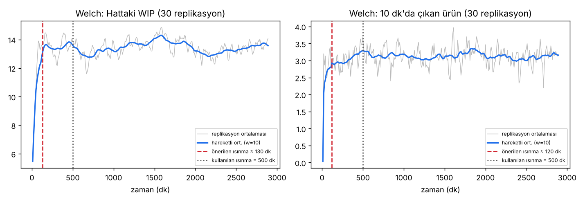
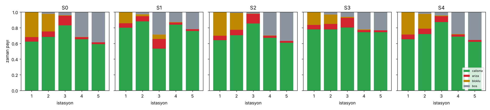
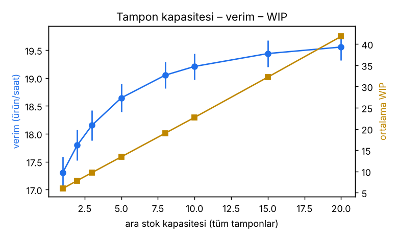

# Deney sonuçları

Koşu: 5000 dk ölçüm + 500 dk ısınma, her senaryo 30 replikasyon, tohumlar 2026..2055 (tüm senaryolarda ortak). Aralıklar %95 güven aralığıdır; Δ sütunları S0'a göre eşleştirilmiş farktır.

| Senaryo   | Açıklama                     |   n | Verim (ürün/saat)   | Çevrim süresi (dk)   | Ortalama WIP   | Darboğaz          | Δ verim              | Δ WIP                           | Δ çevrim             |
|:----------|:-----------------------------|----:|:--------------------|:---------------------|:---------------|:------------------|:---------------------|:--------------------------------|:---------------------|
| S0        | Temel durum                  |  30 | 18.64 ± 0.25        | 43.1 ± 0.6           | 13.43 ± 0.17   | İstasyon 3 (%100) | -                    | -                               | -                    |
| S1        | Darboğaza ikinci operatör    |  30 | 23.98 ± 0.27        | 30.5 ± 0.7           | 12.20 ± 0.32   | İstasyon 2 (%100) | +5.34 [+5.09, +5.58] | -1.23 [-1.43, -1.02]            | -12.6 [-13.2, -12.1] |
| S2        | Tampon büyütme (5→10)        |  30 | 19.21 ± 0.23        | 70.8 ± 1.1           | 22.72 ± 0.31   | İstasyon 3 (%100) | +0.56 [+0.51, +0.62] | +9.29 [+9.13, +9.44]            | +27.6 [+27.1, +28.2] |
| S3        | Hat dengeleme                |  30 | 21.25 ± 0.33        | 34.7 ± 1.0           | 12.30 ± 0.36   | İstasyon 3 (%97)  | +2.60 [+2.50, +2.71] | -1.13 [-1.35, -0.92]            | -8.5 [-8.9, -8.0]    |
| S4        | Arıza azaltma (MTBF 180→300) |  30 | 19.62 ± 0.26        | 41.1 ± 0.6           | 13.45 ± 0.18   | İstasyon 3 (%100) | +0.98 [+0.79, +1.17] | +0.02 [-0.03, +0.07] (anlamsız) | -2.0 [-2.4, -1.6]    |

## İstasyon kullanım oranları (çalışma + arıza)

|            |   S0 |   S1 |   S2 |   S3 |   S4 |
|:-----------|-----:|-----:|-----:|-----:|-----:|
| İstasyon 1 | 68   | 85.8 | 69.9 | 83.7 | 71.3 |
| İstasyon 2 | 75.3 | 94.8 | 77.4 | 84.8 | 78.9 |
| İstasyon 3 | 95.2 | 65.7 | 97.7 | 92.6 | 94.7 |
| İstasyon 4 | 68   | 86.6 | 70   | 77.1 | 71.4 |
| İstasyon 5 | 61.4 | 78.3 | 63.2 | 76.7 | 64.5 |

## Welch ısınma analizi

- WIP serisi: önerilen ısınma ≈ 130 dk (kararlı WIP ≈ 13.49)
- Çıkış serisi: önerilen ısınma ≈ 120 dk
- Kullanılan ısınma: 500 dk; iki serinin de geçiş döneminin yaklaşık 3.8 katı, yani dokümandaki 500 dk kararı güvenli tarafta.

## Tampon duyarlılığı

|   tampon |   verim |   verim_yg |   wip |   wip_yg |   cevrim_suresi |   cevrim_suresi_yg |
|---------:|--------:|-----------:|------:|---------:|----------------:|-------------------:|
|        1 |   17.3  |       0.29 |  5.95 |     0.05 |           20.63 |               0.27 |
|        2 |   17.8  |       0.28 |  7.85 |     0.08 |           26.44 |               0.36 |
|        3 |   18.15 |       0.27 |  9.71 |     0.11 |           32.06 |               0.45 |
|        5 |   18.64 |       0.25 | 13.43 |     0.17 |           43.15 |               0.65 |
|        8 |   19.05 |       0.24 | 19    |     0.25 |           59.68 |               0.93 |
|       10 |   19.21 |       0.23 | 22.72 |     0.31 |           70.79 |               1.13 |
|       15 |   19.44 |       0.24 | 32.21 |     0.46 |           99.19 |               1.7  |
|       20 |   19.55 |       0.23 | 41.79 |     0.58 |          127.93 |               2.24 |

## Gereken replikasyon sayısı

S0 verimi için %1 bağıl yarı genişlik hedefi: **55 replikasyon** (verim 18.63 ± 0.18, bağıl %0.98).
