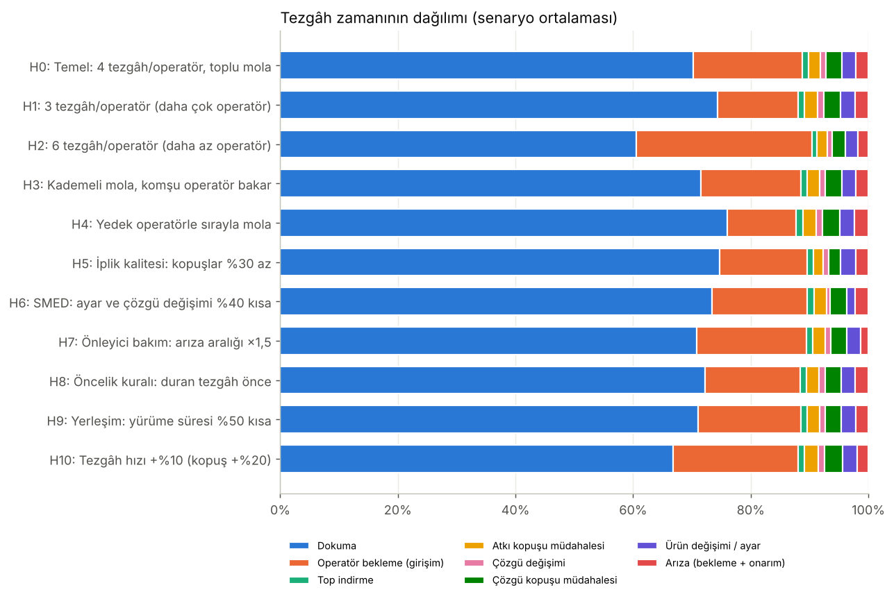
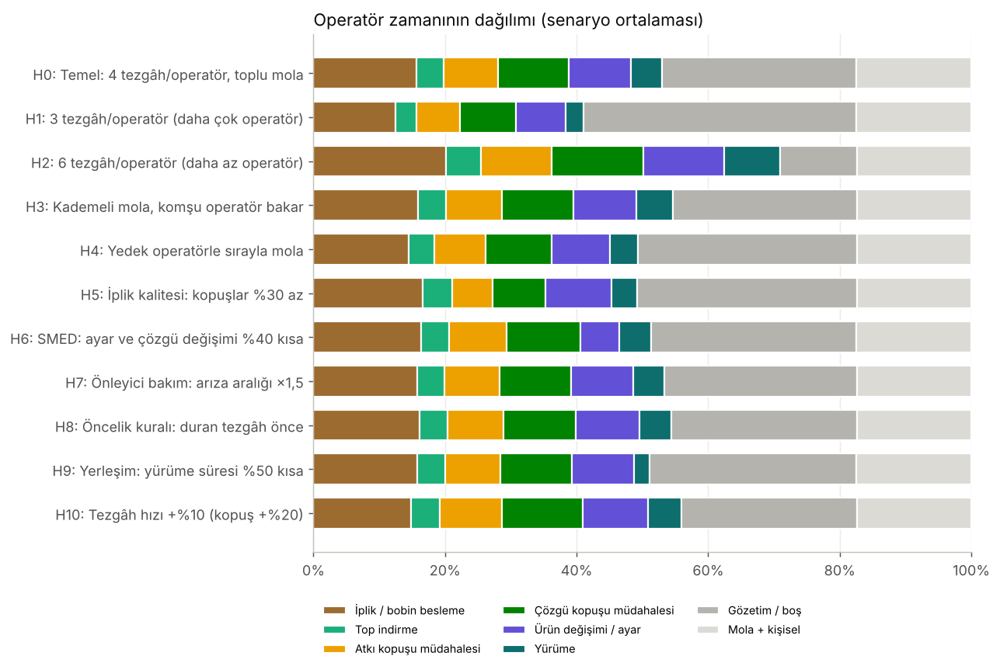
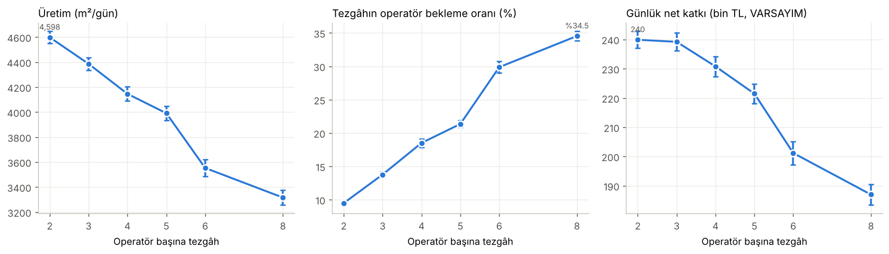

# Halı dokuma salonu: senaryo raporu

> Tüm parametreler **VARSAYIM**dır (fabrika verisi henüz yok). Sonuçlar yöntemi ve
> yönleri gösterir; sayılar iş etüdü ölçümleriyle güncellenince anlam kazanır.
> 20 replikasyon, 7 gün (+8 saat ısınma), ortak rastgele sayılar, %95 güven aralığı.

## Senaryo karşılaştırması

| Senaryo   | Açıklama                              |   Operatör | Üretim (m²/gün)   | Tezgâh dokuma oranı   | Operatör bekleme oranı   | Operatör doluluğu   | m² / operatör-saat   | Ort. müdahale bekleme (dk)   | Δ m²/gün          | Δ %   |
|:----------|:--------------------------------------|-----------:|:------------------|:----------------------|:-------------------------|:--------------------|:---------------------|:-----------------------------|:------------------|:------|
| H0        | Temel: 4 tezgâh/operatör, toplu mola  |          3 | 4138 ± 39         | 0.702 ± 0.004         | 0.185 ± 0.004            | 0.529 ± 0.003       | 57.5 ± 0.5           | 6.43 ± 0.14                  | -                 | -     |
| H1        | 3 tezgâh/operatör (daha çok operatör) |          4 | 4379 ± 37         | 0.743 ± 0.004         | 0.137 ± 0.003            | 0.411 ± 0.003       | 45.6 ± 0.4           | 4.50 ± 0.09                  | +240 [+228, +253] | +5.8  |
| H2        | 6 tezgâh/operatör (daha az operatör)  |          2 | 3562 ± 41         | 0.605 ± 0.005         | 0.298 ± 0.005            | 0.710 ± 0.003       | 74.2 ± 0.9           | 12.00 ± 0.27                 | -576 [-598, -554] | -13.9 |
| H3        | Kademeli mola, komşu operatör bakar   |          3 | 4217 ± 35         | 0.716 ± 0.004         | 0.170 ± 0.003            | 0.546 ± 0.003       | 58.6 ± 0.5           | 5.79 ± 0.12                  | +79 [+68, +90]    | +1.9  |
| H4        | Yedek operatörle sırayla mola         |          4 | 4481 ± 35         | 0.760 ± 0.003         | 0.117 ± 0.002            | 0.493 ± 0.003       | 46.7 ± 0.4           | 3.74 ± 0.07                  | +343 [+325, +361] | +8.3  |
| H5        | İplik kalitesi: kopuşlar %30 az       |          3 | 4402 ± 31         | 0.747 ± 0.003         | 0.149 ± 0.003            | 0.492 ± 0.003       | 61.1 ± 0.4           | 6.76 ± 0.14                  | +264 [+243, +285] | +6.4  |
| H6        | SMED: ayar ve çözgü değişimi %40 kısa |          3 | 4326 ± 34         | 0.734 ± 0.003         | 0.162 ± 0.003            | 0.513 ± 0.003       | 60.1 ± 0.5           | 5.38 ± 0.09                  | +188 [+174, +201] | +4.5  |
| H7        | Önleyici bakım: arıza aralığı ×1,5    |          3 | 4173 ± 39         | 0.708 ± 0.004         | 0.187 ± 0.003            | 0.533 ± 0.003       | 58.0 ± 0.5           | 6.42 ± 0.11                  | +35 [+22, +47]    | +0.8  |
| H8        | Öncelik kuralı: duran tezgâh önce     |          3 | 4259 ± 39         | 0.723 ± 0.004         | 0.162 ± 0.003            | 0.544 ± 0.003       | 59.1 ± 0.5           | 5.45 ± 0.10                  | +121 [+110, +131] | +2.9  |
| H9        | Yerleşim: yürüme süresi %50 kısa      |          3 | 4184 ± 37         | 0.710 ± 0.004         | 0.176 ± 0.003            | 0.511 ± 0.003       | 58.1 ± 0.5           | 6.04 ± 0.12                  | +46 [+38, +53]    | +1.1  |
| H10       | Tezgâh hızı +%10 (kopuş +%20)         |          3 | 4331 ± 39         | 0.668 ± 0.004         | 0.212 ± 0.003            | 0.559 ± 0.003       | 60.1 ± 0.5           | 6.47 ± 0.11                  | +193 [+177, +208] | +4.7  |

Δ sütunu H0'a göre eşleştirilmiş farktır; aralık sıfırı içeriyorsa "(anlamsız)".

## Operatör başına tezgâh sayısı (makine girişimi eğrisi)

Net katkı = m²/gün × 60 TL − operatör sayısı × 24 saat × 250 TL (ikisi de VARSAYIM).

|   tezgah_operator |   operator_sayisi |   m2_gun |   tezgah_verimi |   girisim |   operator_doluluk |   m2_operator_saat |   net_katki_gun |
|------------------:|------------------:|---------:|----------------:|----------:|-------------------:|-------------------:|----------------:|
|                 2 |                 6 |  4598.37 |           0.781 |     0.095 |              0.28  |             31.933 |          239902 |
|                 3 |                 4 |  4386.38 |           0.745 |     0.138 |              0.411 |             45.691 |          239183 |
|                 4 |                 3 |  4146.19 |           0.704 |     0.185 |              0.529 |             57.586 |          230772 |
|                 5 |                 3 |  3991.2  |           0.679 |     0.214 |              0.513 |             55.433 |          221472 |
|                 6 |                 2 |  3553    |           0.606 |     0.299 |              0.709 |             74.021 |          201180 |
|                 8 |                 2 |  3316.29 |           0.564 |     0.345 |              0.664 |             69.089 |          186977 |

## Bir vardiyanın zaman çizelgesi (H0, 2. gün ilk vardiya)

## Sanal iş örneklemesi: kaç gözlem turu yeter?

Her turda bütün operatörler ve tezgâhlar bir kez gözlenir. Tablo, rastgele zamanlı
turlarla tahmin edilen oranların gerçek (simülasyondaki) orandan en çok ne kadar
saptığını gösterir.

|   tur |   operator_gozlem |   operator_maks_hata |   tezgah_maks_hata |
|------:|------------------:|---------------------:|-------------------:|
|    10 |                30 |                0.109 |              0.054 |
|    25 |                75 |                0.078 |              0.043 |
|    50 |               150 |                0.055 |              0.028 |
|   100 |               300 |                0.036 |              0.019 |
|   200 |               600 |                0.028 |              0.014 |
|   400 |              1200 |                0.022 |              0.011 |

100 turluk bir örnekleme ile gerçek oranların karşılaştırması (sahada model doğrulaması
aynı tabloyla yapılır):

| kaynak_tipi   | durum            |   gozlem |   oran |   alt |   ust |   gercek | aralikta   |
|:--------------|:-----------------|---------:|-------:|------:|------:|---------:|:-----------|
| operator      | atki_kopusu      |       19 |  0.063 | 0.036 | 0.091 |    0.081 | True       |
| operator      | ayar             |       23 |  0.077 | 0.047 | 0.107 |    0.103 | True       |
| operator      | besleme          |       56 |  0.187 | 0.143 | 0.231 |    0.146 | True       |
| operator      | cozgu_kopusu     |       38 |  0.127 | 0.089 | 0.164 |    0.114 | True       |
| operator      | gozetim          |       83 |  0.277 | 0.226 | 0.327 |    0.295 | True       |
| operator      | kisisel          |        9 |  0.03  | 0.011 | 0.049 |    0.05  | False      |
| operator      | mola             |       44 |  0.147 | 0.107 | 0.187 |    0.125 | True       |
| operator      | top_indirme      |        9 |  0.03  | 0.011 | 0.049 |    0.04  | True       |
| operator      | yurume           |       19 |  0.063 | 0.036 | 0.091 |    0.046 | True       |
| tezgah        | ariza            |       24 |  0.02  | 0.012 | 0.028 |    0.016 | True       |
| tezgah        | atki_kopusu      |       19 |  0.016 | 0.009 | 0.023 |    0.02  | True       |
| tezgah        | ayar             |       23 |  0.019 | 0.011 | 0.027 |    0.026 | True       |
| tezgah        | cozgu_degisimi   |       14 |  0.012 | 0.006 | 0.018 |    0.012 | True       |
| tezgah        | cozgu_kopusu     |       38 |  0.032 | 0.022 | 0.042 |    0.029 | True       |
| tezgah        | dokuma           |      850 |  0.708 | 0.683 | 0.734 |    0.7   | True       |
| tezgah        | operator_bekleme |      223 |  0.186 | 0.164 | 0.208 |    0.187 | True       |
| tezgah        | top_indirme      |        9 |  0.008 | 0.003 | 0.012 |    0.01  | True       |
