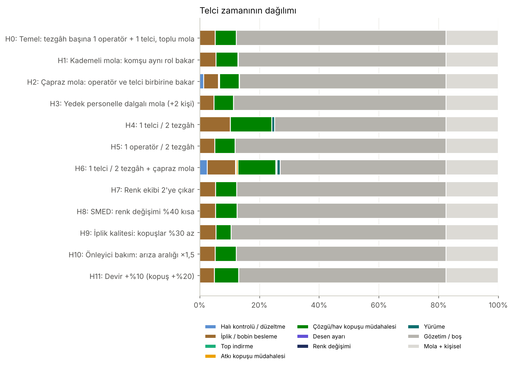
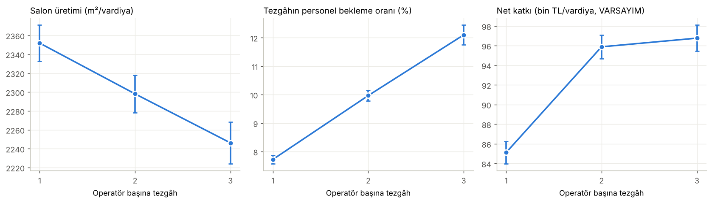
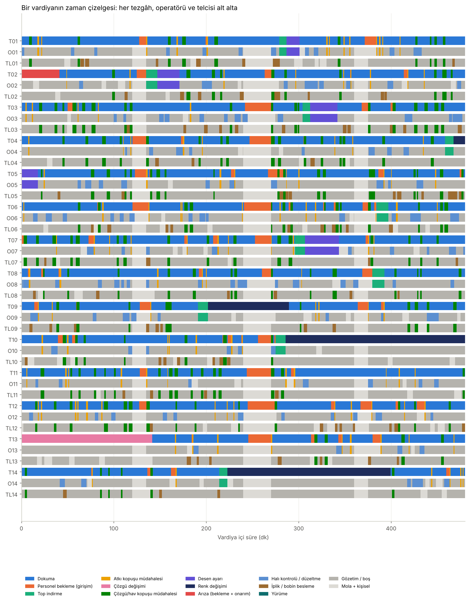

# Halı dokuma salonu: senaryo raporu

> Tezgâh bilgileri (marka, tarak, en, renk, tarak sayısı) ve personel düzeni fabrikadan gelir;
> devir, sıra sıklığı, kopuş, süre ve olasılıkların hepsi **VARSAYIM**dır. Sonuçlar yöntemi ve
> yönleri gösterir; sayılar iş etüdü ölçümleriyle güncellenince anlam kazanır.
> 20 replikasyon, 7 gün (+8 saat ısınma), ortak rastgele sayılar, %95 güven aralığı. Ana ölçüt m²/vardiya.

## Tezgâhlar

| Tezgâh   | Marka                  |   Tarak (10 cm) |   En (m) |   Renk |   Tarak sayısı |   Sıra (10 cm) | Devir (/dk)        |   Ort. m²/saat (kesintisiz) |
|:---------|:-----------------------|----------------:|---------:|-------:|---------------:|---------------:|:-------------------|----------------------------:|
| T01      | Schönherr              |              42 |        5 |      8 |           2100 |             63 | Üçgen(70, 85, 100) |                        40.5 |
| T02      | Van De Wiele           |              42 |        4 |      7 |           1680 |             63 | Üçgen(70, 85, 100) |                        32.4 |
| T03      | Van De Wiele           |              42 |        4 |      7 |           1716 |             63 | Üçgen(70, 85, 100) |                        32.4 |
| T04      | Van De Wiele           |              42 |        4 |      7 |           1716 |             63 | Üçgen(70, 85, 100) |                        32.4 |
| T05      | Van De Wiele           |              42 |        4 |      7 |           1680 |             63 | Üçgen(70, 85, 100) |                        32.4 |
| T06      | Schönherr              |              50 |        4 |      6 |           2000 |             75 | Üçgen(70, 85, 100) |                        27.2 |
| T07      | Schönherr              |              50 |        4 |      8 |           2000 |             75 | Üçgen(70, 85, 100) |                        27.2 |
| T08      | Schönherr              |              50 |        4 |      8 |           2000 |             75 | Üçgen(70, 85, 100) |                        27.2 |
| T09      | Van De Wiele-Schönherr |              50 |        4 |      8 |           2000 |             75 | Üçgen(70, 85, 100) |                        27.2 |
| T10      | Van De Wiele           |              50 |        4 |      8 |           2020 |             75 | Üçgen(70, 85, 100) |                        27.2 |
| T11      | Schönherr              |              70 |        4 |      8 |           2800 |            105 | Üçgen(70, 85, 100) |                        19.4 |
| T12      | Van De Wiele           |              50 |        4 |      8 |           2000 |             75 | Üçgen(70, 85, 100) |                        27.2 |
| T13      | Van De Wiele           |              42 |        4 |      7 |           1680 |             63 | Üçgen(70, 85, 100) |                        32.4 |
| T14      | Van De Wiele           |              42 |        4 |      7 |           1680 |             63 | Üçgen(70, 85, 100) |                        32.4 |

## Senaryo karşılaştırması

| Senaryo   | Açıklama                                              |   Personel | Salon m²/vardiya   | Tezgâh başına m²/vardiya   | Dokuma oranı   | Personel bekleme oranı   | Operatör doluluğu   | Telci doluluğu   | m² / personel-saat   | Δ m²/vardiya      | Δ %   |
|:----------|:------------------------------------------------------|-----------:|:-------------------|:---------------------------|:---------------|:-------------------------|:--------------------|:-----------------|:---------------------|:------------------|:------|
| H0        | Temel: tezgâh başına 1 operatör + 1 telci, toplu mola |         28 | 2357 ± 10          | 168.4 ± 0.7                | 0.711 ± 0.003  | 0.078 ± 0.001            | 0.167 ± 0.001       | 0.123 ± 0.001    | 10.5 ± 0.0           | -                 | -     |
| H1        | Kademeli mola: komşu aynı rol bakar                   |         28 | 2472 ± 10          | 176.6 ± 0.7                | 0.745 ± 0.003  | 0.030 ± 0.000            | 0.177 ± 0.001       | 0.131 ± 0.001    | 11.0 ± 0.0           | +115 [+110, +119] | +4.9  |
| H2        | Çapraz mola: operatör ve telci birbirine bakar        |         28 | 2489 ± 11          | 177.8 ± 0.8                | 0.751 ± 0.003  | 0.026 ± 0.000            | 0.171 ± 0.002       | 0.135 ± 0.001    | 11.1 ± 0.0           | +132 [+127, +136] | +5.6  |
| H3        | Yedek personelle dalgalı mola (+2 kişi)               |         30 | 2478 ± 10          | 177.0 ± 0.7                | 0.747 ± 0.003  | 0.028 ± 0.001            | 0.154 ± 0.001       | 0.114 ± 0.001    | 10.3 ± 0.0           | +121 [+116, +126] | +5.1  |
| H4        | 1 telci / 2 tezgâh                                    |         21 | 2326 ± 10          | 166.1 ± 0.7                | 0.701 ± 0.003  | 0.090 ± 0.001            | 0.165 ± 0.001       | 0.252 ± 0.002    | 13.8 ± 0.1           | -32 [-36, -27]    | -1.3  |
| H5        | 1 operatör / 2 tezgâh                                 |         21 | 2298 ± 10          | 164.2 ± 0.7                | 0.693 ± 0.003  | 0.101 ± 0.001            | 0.337 ± 0.003       | 0.119 ± 0.001    | 13.7 ± 0.1           | -59 [-63, -55]    | -2.5  |
| H6        | 1 telci / 2 tezgâh + çapraz mola                      |         21 | 2441 ± 9           | 174.4 ± 0.6                | 0.736 ± 0.003  | 0.043 ± 0.001            | 0.172 ± 0.001       | 0.270 ± 0.002    | 14.5 ± 0.1           | +84 [+80, +88]    | +3.6  |
| H7        | Renk ekibi 2'ye çıkar                                 |         28 | 2389 ± 9           | 170.7 ± 0.6                | 0.720 ± 0.002  | 0.079 ± 0.001            | 0.169 ± 0.001       | 0.124 ± 0.001    | 10.7 ± 0.0           | +32 [+24, +40]    | +1.4  |
| H8        | SMED: renk değişimi %40 kısa                          |         28 | 2424 ± 9           | 173.1 ± 0.6                | 0.730 ± 0.002  | 0.079 ± 0.001            | 0.169 ± 0.001       | 0.126 ± 0.001    | 10.8 ± 0.0           | +66 [+59, +74]    | +2.8  |
| H9        | İplik kalitesi: kopuşlar %30 az                       |         28 | 2467 ± 13          | 176.2 ± 0.9                | 0.744 ± 0.004  | 0.061 ± 0.001            | 0.168 ± 0.002       | 0.107 ± 0.001    | 11.0 ± 0.1           | +109 [+101, +117] | +4.6  |
| H10       | Önleyici bakım: arıza aralığı ×1,5                    |         28 | 2370 ± 9           | 169.3 ± 0.7                | 0.714 ± 0.003  | 0.078 ± 0.001            | 0.168 ± 0.002       | 0.123 ± 0.001    | 10.6 ± 0.0           | +12 [+8, +16]     | +0.5  |
| H11       | Devir +%10 (kopuş +%20)                               |         28 | 2486 ± 10          | 177.6 ± 0.7                | 0.681 ± 0.003  | 0.086 ± 0.001            | 0.168 ± 0.002       | 0.131 ± 0.001    | 11.1 ± 0.0           | +128 [+121, +136] | +5.4  |

Δ sütunu H0'a göre eşleştirilmiş farktır; aralık sıfırı içeriyorsa "(anlamsız)".

## Kişi başına tezgâh sayısı (makine girişimi eğrisi)

Net katkı/vardiya = m²/vardiya × 60 TL − personel × 8 saat × 250 TL (ikisi de VARSAYIM).

### Telci

|   tezgah_kisi |   kisi_sayisi |   personel_sayisi |   m2_vardiya |   tezgah_verimi |   girisim |   telci_doluluk |   m2_personel_saat |   net_katki_vardiya |
|--------------:|--------------:|------------------:|-------------:|----------------:|----------:|----------------:|-------------------:|--------------------:|
|             1 |            14 |                28 |      2351.95 |           0.709 |     0.077 |           0.122 |             10.5   |             85116.8 |
|             2 |             7 |                21 |      2319.45 |           0.699 |     0.09  |           0.251 |             13.806 |             97166.7 |
|             3 |             5 |                19 |      2295.52 |           0.691 |     0.102 |           0.355 |             15.102 |             99731.2 |
|             4 |             4 |                18 |      2256.47 |           0.679 |     0.116 |           0.445 |             15.67  |             99388.4 |

### Operatör

|   tezgah_kisi |   kisi_sayisi |   personel_sayisi |   m2_vardiya |   tezgah_verimi |   girisim |   operator_doluluk |   m2_personel_saat |   net_katki_vardiya |
|--------------:|--------------:|------------------:|-------------:|----------------:|----------:|-------------------:|-------------------:|--------------------:|
|             1 |            14 |                28 |      2351.95 |           0.709 |     0.077 |              0.166 |             10.5   |             85116.8 |
|             2 |             7 |                21 |      2298.14 |           0.692 |     0.1   |              0.336 |             13.679 |             95888.7 |
|             3 |             5 |                19 |      2246.19 |           0.676 |     0.121 |              0.468 |             14.778 |             96771.5 |

## Bir vardiyanın zaman çizelgesi (H0, 2. gün ilk vardiya)

## Sanal iş örneklemesi: kaç gözlem turu yeter?

Her turda bütün tezgâhlar, operatörler ve telciler bir kez gözlenir
(42 gözlem/tur). Tablo, rastgele zamanlı turlarla tahmin edilen
oranların gerçek (simülasyondaki) orandan en çok kaç puan saptığını gösterir.

|   tur |   gozlem_tur_basina |   operator_maks_hata |   telci_maks_hata |   tezgah_maks_hata |
|------:|--------------------:|---------------------:|------------------:|-------------------:|
|    10 |                  42 |                0.083 |             0.081 |              0.055 |
|    25 |                  42 |                0.055 |             0.056 |              0.034 |
|    50 |                  42 |                0.044 |             0.046 |              0.026 |
|   100 |                  42 |                0.03  |             0.033 |              0.019 |
|   200 |                  42 |                0.021 |             0.02  |              0.012 |
|   400 |                  42 |                0.018 |             0.019 |              0.009 |

