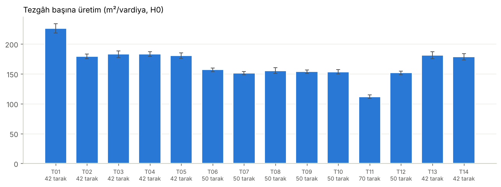
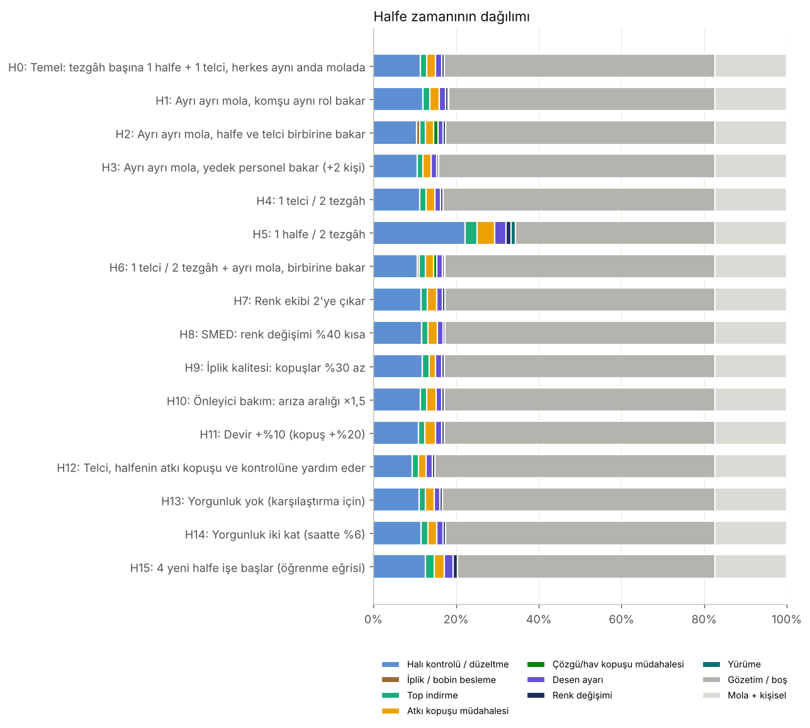
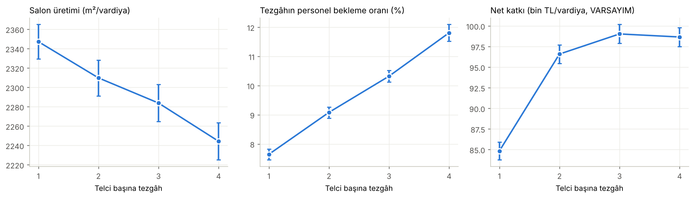
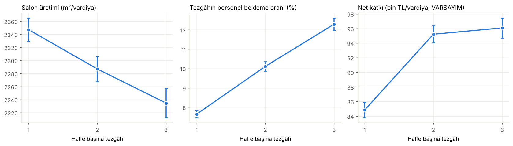
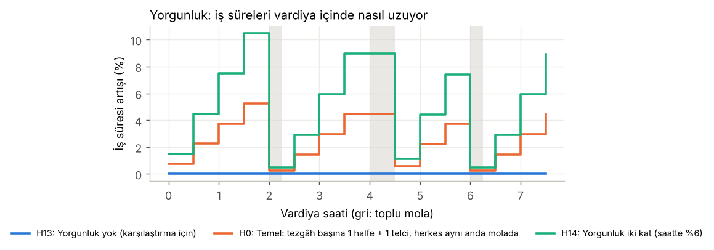
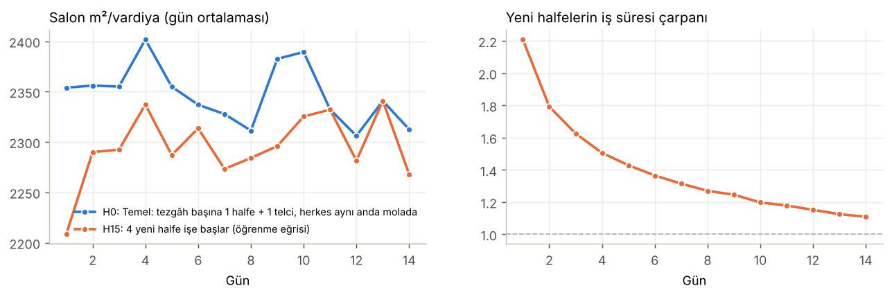
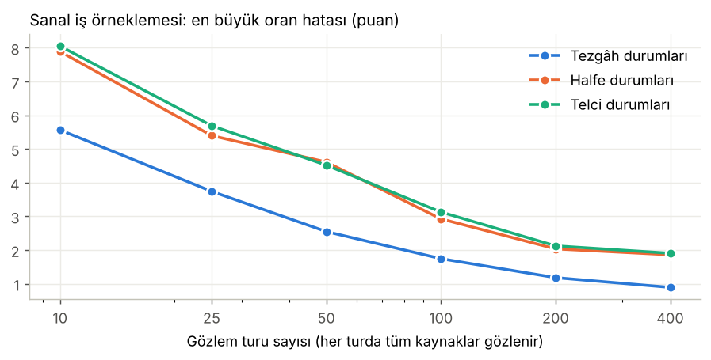

# Halı dokuma salonu: senaryo raporu

> Tezgâh bilgileri (marka, tarak, en, renk, tarak sayısı) ve personel düzeni fabrikadan gelir;
> devir, sıra sıklığı, kopuş, süre ve olasılıkların hepsi **VARSAYIM**dır. Sonuçlar yöntemi ve
> yönleri gösterir; sayılar iş etüdü ölçümleriyle güncellenince anlam kazanır.
> 20 replikasyon, 7 gün (+8 saat ısınma), ortak rastgele sayılar, %95 güven aralığı. Ana ölçüt m²/vardiya.

## Tezgâhlar

| Tezgâh   | Marka                  |   Tarak (10 cm) |   En (m) |   Renk |   Tarak sayısı |   Sıra (10 cm) | Devir (/dk)        |   Ort. m²/saat (kesintisiz) |
|:---------|:-----------------------|----------------:|---------:|-------:|---------------:|---------------:|:-------------------|----------------------------:|
| T01      | Schönherr              |              42 |        5 |      8 |           2100 |             63 | Üçgen(70, 85, 100) |                        40.5 |
| T02      | Van De Wiele           |              42 |        4 |      7 |           1680 |             63 | Üçgen(70, 85, 100) |                        32.4 |
| T03      | Van De Wiele           |              42 |        4 |      7 |           1716 |             63 | Üçgen(70, 85, 100) |                        32.4 |
| T04      | Van De Wiele           |              42 |        4 |      7 |           1716 |             63 | Üçgen(70, 85, 100) |                        32.4 |
| T05      | Van De Wiele           |              42 |        4 |      7 |           1680 |             63 | Üçgen(70, 85, 100) |                        32.4 |
| T06      | Schönherr              |              50 |        4 |      6 |           2000 |             75 | Üçgen(70, 85, 100) |                        27.2 |
| T07      | Schönherr              |              50 |        4 |      8 |           2000 |             75 | Üçgen(70, 85, 100) |                        27.2 |
| T08      | Schönherr              |              50 |        4 |      8 |           2000 |             75 | Üçgen(70, 85, 100) |                        27.2 |
| T09      | Van De Wiele-Schönherr |              50 |        4 |      8 |           2000 |             75 | Üçgen(70, 85, 100) |                        27.2 |
| T10      | Van De Wiele           |              50 |        4 |      8 |           2020 |             75 | Üçgen(70, 85, 100) |                        27.2 |
| T11      | Schönherr              |              70 |        4 |      8 |           2800 |            105 | Üçgen(70, 85, 100) |                        19.4 |
| T12      | Van De Wiele           |              50 |        4 |      8 |           2000 |             75 | Üçgen(70, 85, 100) |                        27.2 |
| T13      | Van De Wiele           |              42 |        4 |      7 |           1680 |             63 | Üçgen(70, 85, 100) |                        32.4 |
| T14      | Van De Wiele           |              42 |        4 |      7 |           1680 |             63 | Üçgen(70, 85, 100) |                        32.4 |

## Senaryo karşılaştırması

| Senaryo   | Açıklama                                                        |   Personel | Salon m²/vardiya   | Tezgâh başına m²/vardiya   | Dokuma oranı   | Personel bekleme oranı   | Halfe doluluğu   | Ort. yorgunluk çarpanı   | Telci doluluğu   | m² / personel-saat   | Δ m²/vardiya      | Δ %   |
|:----------|:----------------------------------------------------------------|-----------:|:-------------------|:---------------------------|:---------------|:-------------------------|:-----------------|:-------------------------|:-----------------|:---------------------|:------------------|:------|
| H0        | Temel: tezgâh başına 1 halfe + 1 telci, herkes aynı anda molada |         28 | 2351 ± 9           | 167.9 ± 0.6                | 0.709 ± 0.003  | 0.077 ± 0.001            | 0.171 ± 0.001    | 1.024 ± 0.000            | 0.125 ± 0.001    | 10.5 ± 0.0           | -                 | -     |
| H1        | Ayrı ayrı mola, komşu aynı rol bakar                            |         28 | 2473 ± 11          | 176.6 ± 0.8                | 0.746 ± 0.003  | 0.027 ± 0.001            | 0.182 ± 0.001    | 1.028 ± 0.000            | 0.135 ± 0.001    | 11.0 ± 0.0           | +122 [+116, +127] | +5.2  |
| H2        | Ayrı ayrı mola, halfe ve telci birbirine bakar                  |         28 | 2478 ± 10          | 177.0 ± 0.7                | 0.747 ± 0.003  | 0.025 ± 0.000            | 0.174 ± 0.001    | 1.029 ± 0.000            | 0.139 ± 0.001    | 11.1 ± 0.0           | +128 [+123, +133] | +5.4  |
| H3        | Ayrı ayrı mola, yedek personel bakar (+2 kişi)                  |         30 | 2461 ± 10          | 175.8 ± 0.7                | 0.742 ± 0.003  | 0.030 ± 0.000            | 0.158 ± 0.001    | 1.042 ± 0.000            | 0.116 ± 0.001    | 10.3 ± 0.0           | +110 [+105, +115] | +4.7  |
| H4        | 1 telci / 2 tezgâh                                              |         21 | 2316 ± 10          | 165.5 ± 0.7                | 0.698 ± 0.003  | 0.091 ± 0.001            | 0.168 ± 0.001    | 1.025 ± 0.000            | 0.257 ± 0.002    | 13.8 ± 0.1           | -34 [-38, -30]    | -1.5  |
| H5        | 1 halfe / 2 tezgâh                                              |         21 | 2285 ± 10          | 163.2 ± 0.7                | 0.689 ± 0.003  | 0.102 ± 0.002            | 0.343 ± 0.003    | 1.025 ± 0.000            | 0.122 ± 0.001    | 13.6 ± 0.1           | -66 [-70, -61]    | -2.8  |
| H6        | 1 telci / 2 tezgâh + ayrı mola, birbirine bakar                 |         21 | 2401 ± 11          | 171.5 ± 0.8                | 0.724 ± 0.003  | 0.056 ± 0.001            | 0.173 ± 0.002    | 1.028 ± 0.000            | 0.273 ± 0.002    | 14.3 ± 0.1           | +50 [+45, +55]    | +2.1  |
| H7        | Renk ekibi 2'ye çıkar                                           |         28 | 2380 ± 8           | 170.0 ± 0.6                | 0.717 ± 0.002  | 0.079 ± 0.001            | 0.173 ± 0.001    | 1.025 ± 0.000            | 0.127 ± 0.001    | 10.6 ± 0.0           | +29 [+23, +36]    | +1.2  |
| H8        | SMED: renk değişimi %40 kısa                                    |         28 | 2413 ± 8           | 172.3 ± 0.5                | 0.727 ± 0.002  | 0.080 ± 0.001            | 0.173 ± 0.001    | 1.025 ± 0.000            | 0.129 ± 0.001    | 10.8 ± 0.0           | +62 [+55, +69]    | +2.6  |
| H9        | İplik kalitesi: kopuşlar %30 az                                 |         28 | 2460 ± 12          | 175.7 ± 0.8                | 0.742 ± 0.004  | 0.062 ± 0.001            | 0.172 ± 0.002    | 1.024 ± 0.000            | 0.109 ± 0.001    | 11.0 ± 0.1           | +110 [+103, +117] | +4.7  |
| H10       | Önleyici bakım: arıza aralığı ×1,5                              |         28 | 2360 ± 10          | 168.5 ± 0.7                | 0.711 ± 0.003  | 0.079 ± 0.001            | 0.171 ± 0.002    | 1.025 ± 0.000            | 0.126 ± 0.001    | 10.5 ± 0.0           | +9 [+4, +14]      | +0.4  |
| H11       | Devir +%10 (kopuş +%20)                                         |         28 | 2478 ± 10          | 177.0 ± 0.7                | 0.679 ± 0.003  | 0.086 ± 0.001            | 0.171 ± 0.002    | 1.025 ± 0.000            | 0.134 ± 0.001    | 11.1 ± 0.0           | +127 [+120, +135] | +5.4  |
| H12       | Telci, halfenin atkı kopuşu ve kontrolüne yardım eder           |         28 | 2373 ± 10          | 169.5 ± 0.7                | 0.716 ± 0.003  | 0.067 ± 0.001            | 0.148 ± 0.001    | 1.024 ± 0.000            | 0.151 ± 0.001    | 10.6 ± 0.0           | +22 [+18, +27]    | +0.9  |
| H13       | Yorgunluk yok (karşılaştırma için)                              |         28 | 2357 ± 10          | 168.4 ± 0.7                | 0.711 ± 0.003  | 0.078 ± 0.001            | 0.167 ± 0.001    | 1.000 ± 0.000            | 0.123 ± 0.001    | 10.5 ± 0.0           | +7 [+4, +9]       | +0.3  |
| H14       | Yorgunluk iki kat (saatte %6)                                   |         28 | 2340 ± 10          | 167.1 ± 0.7                | 0.705 ± 0.003  | 0.078 ± 0.001            | 0.174 ± 0.001    | 1.049 ± 0.000            | 0.128 ± 0.001    | 10.4 ± 0.0           | -11 [-14, -8]     | -0.5  |
| H15       | 4 yeni halfe işe başlar (öğrenme eğrisi)                        |         28 | 2290 ± 9           | 163.5 ± 0.6                | 0.689 ± 0.003  | 0.081 ± 0.001            | 0.204 ± 0.002    | 1.025 ± 0.000            | 0.122 ± 0.001    | 10.2 ± 0.0           | -61 [-67, -55]    | -2.6  |

Δ sütunu H0'a göre eşleştirilmiş farktır; aralık sıfırı içeriyorsa "(anlamsız)".

## Kişi başına tezgâh sayısı (makine girişimi eğrisi)

Net katkı/vardiya = m²/vardiya × 60 TL − personel × 8 saat × 250 TL (ikisi de VARSAYIM).

### Telci

|   tezgah_kisi |   kisi_sayisi |   personel_sayisi |   m2_vardiya |   tezgah_verimi |   girisim |   telci_doluluk |   m2_personel_saat |   net_katki_vardiya |
|--------------:|--------------:|------------------:|-------------:|----------------:|----------:|----------------:|-------------------:|--------------------:|
|             1 |            14 |                28 |      2347.25 |           0.707 |     0.076 |           0.125 |             10.479 |             84835.1 |
|             2 |             7 |                21 |      2309.82 |           0.696 |     0.091 |           0.256 |             13.749 |             96589.3 |
|             3 |             5 |                19 |      2283.83 |           0.688 |     0.103 |           0.362 |             15.025 |             99030   |
|             4 |             4 |                18 |      2244.33 |           0.675 |     0.118 |           0.452 |             15.586 |             98660   |

### Halfe

|   tezgah_kisi |   kisi_sayisi |   personel_sayisi |   m2_vardiya |   tezgah_verimi |   girisim |   halfe_doluluk |   m2_personel_saat |   net_katki_vardiya |
|--------------:|--------------:|------------------:|-------------:|----------------:|----------:|----------------:|-------------------:|--------------------:|
|             1 |            14 |                28 |      2347.25 |           0.707 |     0.076 |           0.17  |             10.479 |             84835.1 |
|             2 |             7 |                21 |      2286.96 |           0.689 |     0.101 |           0.343 |             13.613 |             95217.4 |
|             3 |             5 |                19 |      2234.7  |           0.673 |     0.123 |           0.477 |             14.702 |             96082.2 |

## Yorgunluk

İş süresi, son moladan (ya da vardiya başından) bu yana geçen her saat için
%3 uzar, tavan %25; molada sıfırlanır (VARSAYIM).
Ölçmek için: zaman etüdü gözlemlerine vardiya saatini yazın; `zaman_etudu_analiz` saat başına eğimi verir.

## Öğrenme eğrisi (4 yeni halfe, 14 gün)

Yeni halfenin iş süresi Wright eğrisiyle (tekrar / 500)^log2(0.85)
çarpanı alır; 500. tekrardan sonra standart süreye iner (VARSAYIM).

|   gun |   H0 |   H15 |
|------:|-----:|------:|
|     1 | 2354 |  2208 |
|     2 | 2356 |  2290 |
|     3 | 2355 |  2292 |
|     4 | 2402 |  2337 |
|     5 | 2355 |  2287 |
|     6 | 2337 |  2314 |
|     7 | 2328 |  2273 |
|     8 | 2311 |  2284 |
|     9 | 2383 |  2296 |
|    10 | 2389 |  2325 |
|    11 | 2332 |  2332 |
|    12 | 2306 |  2281 |
|    13 | 2341 |  2341 |
|    14 | 2313 |  2268 |

## Bir vardiyanın zaman çizelgesi (H0, 2. gün ilk vardiya)

## Sanal iş örneklemesi: kaç gözlem turu yeter?

Her turda bütün tezgâhlar, halfeler ve telciler bir kez gözlenir
(42 gözlem/tur). Tablo, rastgele zamanlı turlarla tahmin edilen
oranların gerçek (simülasyondaki) orandan en çok kaç puan saptığını gösterir.

|   tur |   gozlem_tur_basina |   halfe_maks_hata |   telci_maks_hata |   tezgah_maks_hata |
|------:|--------------------:|------------------:|------------------:|-------------------:|
|    10 |                  42 |             0.079 |             0.081 |              0.056 |
|    25 |                  42 |             0.054 |             0.057 |              0.037 |
|    50 |                  42 |             0.046 |             0.045 |              0.025 |
|   100 |                  42 |             0.029 |             0.031 |              0.017 |
|   200 |                  42 |             0.02  |             0.021 |              0.012 |
|   400 |                  42 |             0.019 |             0.019 |              0.009 |

